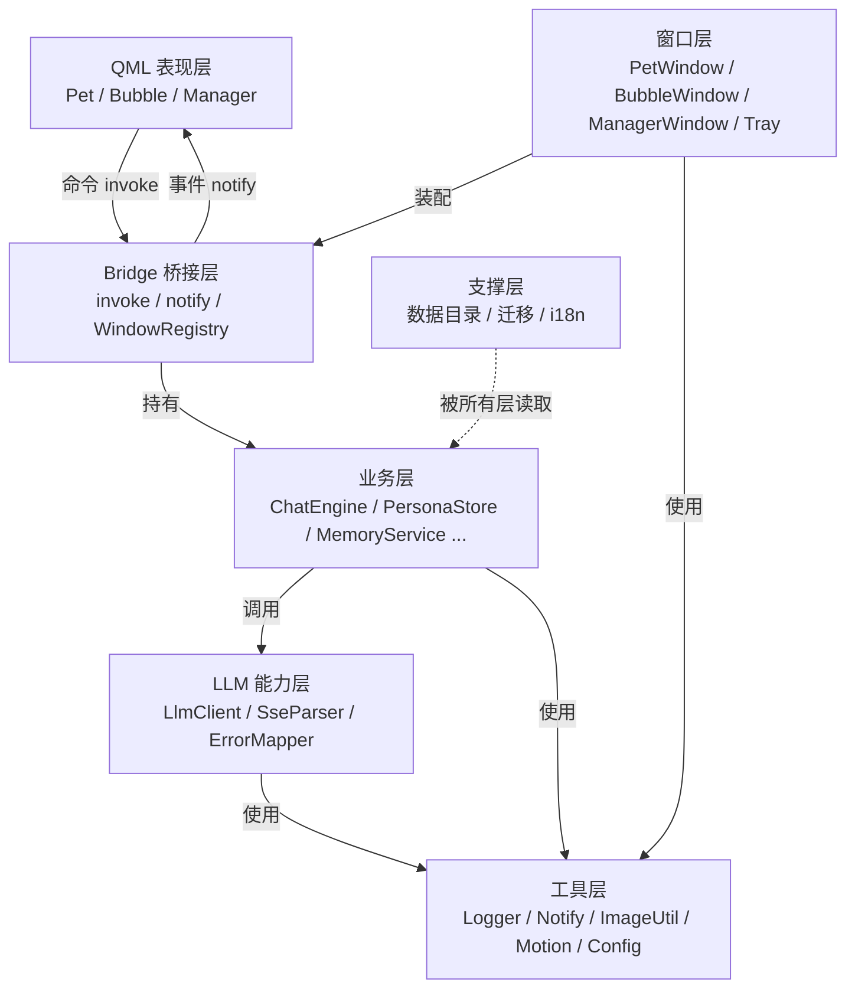
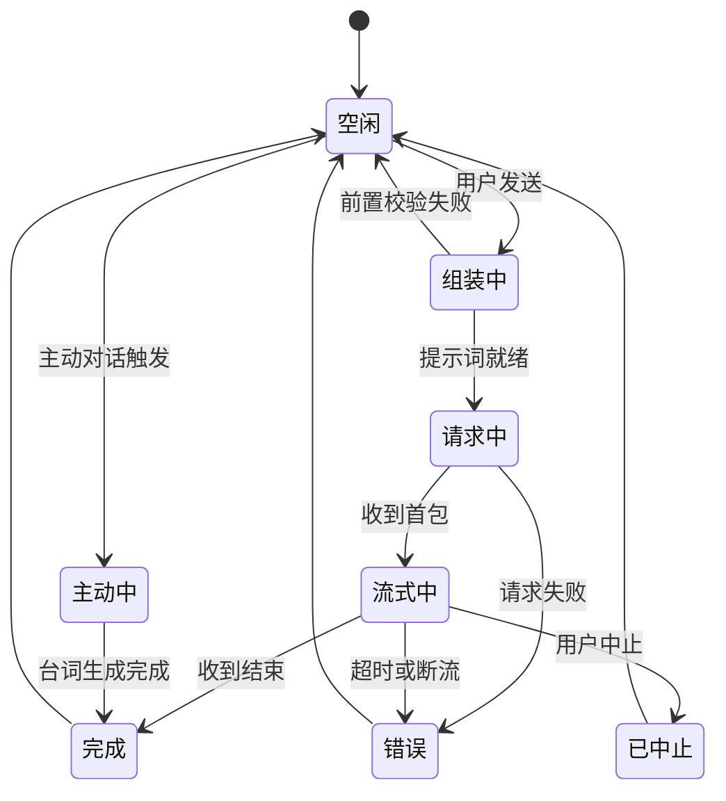
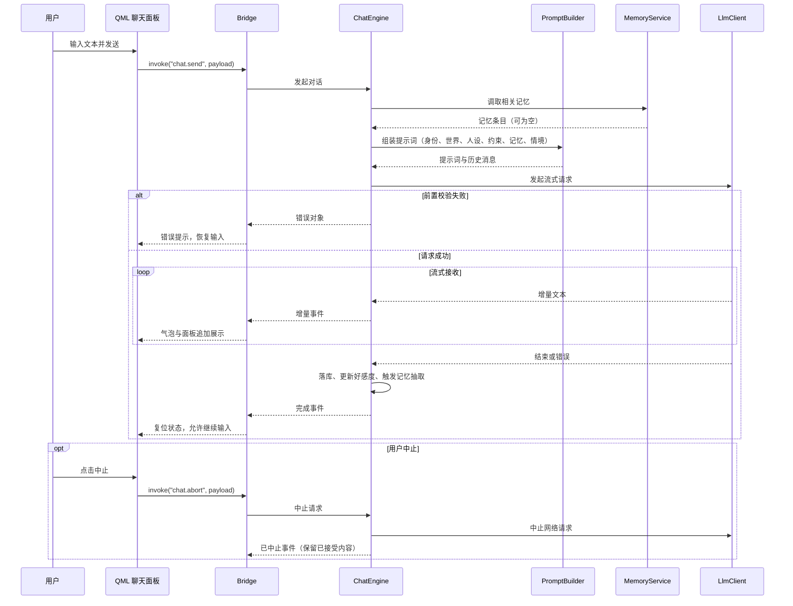
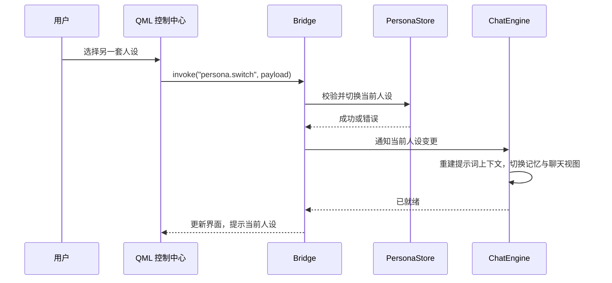
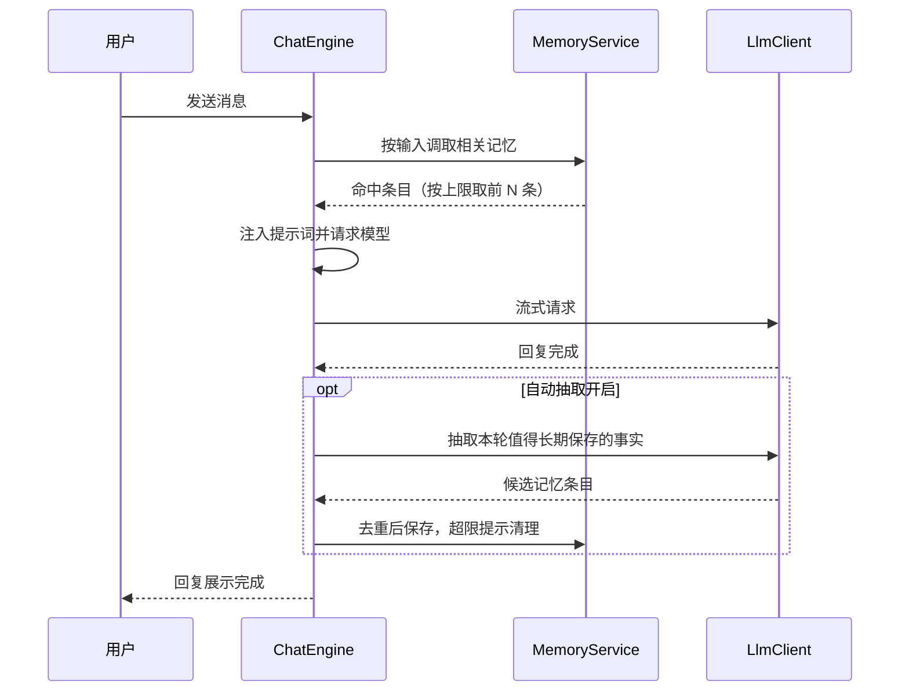
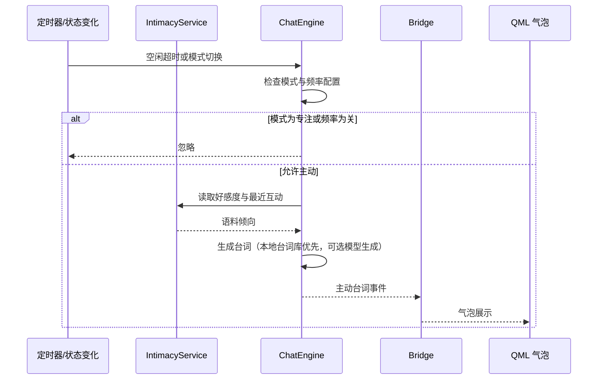
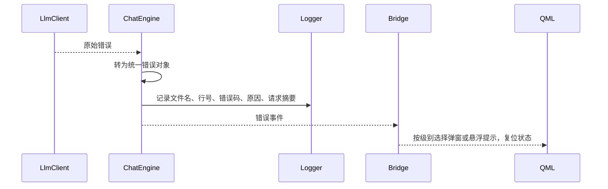

# 桌面桌宠（desktop_companion）项目设计

> 本文档按《设计方案模板》格式编写；项目名、人员、路径、版本号等按实际替换；示例性表述以最终实现为准。

---

## 一、项目概述

### 1.1 项目简介
本项目是一个常驻桌面的 AI 桌宠软件。启动后在桌面唤出可自定义形象的桌宠，支持点击互动与文字对话；对话可接入任意 OpenAI 兼容 API（云端或本地 Ollama / LM Studio），角色人格由导入的 `人设.md` 定义，全部数据保存在本地，不依赖账号与服务端。

### 1.2 目标用户
希望桌面上有一只可聊天、可自定义形象的桌宠的个人用户。
已持有本地或云端大模型 API、希望自带模型能力的用户。
注重隐私、不希望聊天数据上云的用户。
不面向企业批量部署场景。

### 1.3 主要功能
核心功能：桌宠显示与互动，文字对话，模型接入，人设导入。
其他功能：气泡反馈，聊天面板，控制中心，记忆系统，多套人设，世界观，好感度，主动对话，全局快捷键，系统托盘，悬浮球，贴边隐藏，多语言，主题切换，聊天记录导出。
次要功能：新手引导，关于与版本信息，手动检查更新，日志查看，命中区调试开关。

### 1.4 技术约束
语言标准：C++20。
Qt 版本：6.12.0（目标机 `/opt/Qt/6.12.0/gcc_arm64`）。
构建编译：CMake 3.28 + Ninja + 目标机系统 g++ 13.3。
系统要求：目标机 Ubuntu 24.04 aarch64（触屏设备）编译、运行通过；开发机 x86_64 亦可编译（Qt 6.10 及以上）。
版本管理：Git 本地仓库。
运行依赖：除 Qt 外不依赖第三方库。
单实例：软件运行时要求单实例。
编译产物：不超过 100 MB。

---

## 二、项目需求

### 2.1 总体需求与优先级

需求编号规则：`前缀-优先级-序号`。前缀 `G` 表示全局需求；`PET`（桌宠交互）、`CHAT`（对话与气泡）、`LLM`（模型接入）、`PSN`（人设）、`WLD`（世界观）、`MEM`（记忆）、`INT`（好感度）、`MGR`（控制中心）、`SYS`（系统集成）分别表示各功能需求。优先级中缀 `H` 为高、`M` 为中、`L` 为低；序号在同一前缀、同一优先级内递增。多个功能重复的共性需求（结果反馈、异步执行、日志、单实例、配置持久化等）统一放进全局表，各功能表只保留特有需求。

| 编号 | 需求描述 |
|---|---|
| G-H-01 | 软件单例运行，二次启动激活已有窗口并退出 |
| G-H-02 | 日志埋于业务线之中，能还原用户操作流程与操作结果 |
| G-H-03 | 发生错误有通知，原因有反馈，不得静默失败 |
| G-H-04 | 耗时操作一律异步执行，UI 不冻结 |
| G-H-05 | 后端操作失败有错误处理，软件不得崩溃 |
| G-H-06 | 操作结果有明确反馈，先复位状态再反馈结果 |
| G-H-07 | 核心配置（模型、角色、人设、模式）集中管理，消除硬编码 |
| G-H-08 | 数据全本地存储，路径使用 `QStandardPaths`，禁止写死绝对路径 |
| G-H-09 | 配置文件与数据文件采用原子写，损坏时回退默认值并提示 |
| G-H-10 | 用户可见文案统一走翻译接口，为多语言预留 |
| G-M-01 | 支持亮暗主题切换 |
| G-M-02 | 支持中英语言切换 |
| G-M-03 | 支持全局快捷键操作 |
| G-M-04 | 支持托盘常驻与开机自启 |
| G-M-05 | 支持聊天记录与角色包的导入导出 |
| G-L-01 | 初次使用有新手引导 |
| G-L-02 | 重要按钮带文字，次要按钮以图标显示并附悬浮说明 |
| G-L-03 | 日志可按需查看与导出，便于问题排查 |

### 2.2 桌宠交互

| 编号 | 需求描述 |
|---|---|
| PET-H-01 | 启动后在桌面唤出桌宠，无边框、透明背景、置顶显示、不占任务栏 |
| PET-H-02 | 桌宠形象可自定义，导入透明 PNG 即生效 |
| PET-H-03 | 点击桌宠触发动作与台词气泡，不同命中区播放不同动作 |
| PET-H-04 | 桌宠可拖动，松开后落位并记忆位置 |
| PET-H-05 | 透明区域点击可穿透到桌面或其他窗口，宠物实心区域可点击 |
| PET-H-06 | 右键菜单：聊天、切换角色、打开控制中心、点击穿透开关、隐藏、退出 |
| PET-H-07 | 待机动效（呼吸、浮动）可开关与调力度 |
| PET-M-01 | 双击桌宠打开聊天面板 |
| PET-M-02 | 拖到屏幕边缘自动贴边隐藏，悬停展开 |
| PET-M-03 | 支持收纳为悬浮球，点击恢复桌宠 |
| PET-M-04 | 拖拽过程中播放拖起、拖拽、放下三态动效 |
| PET-M-05 | 点击与拖拽以位移阈值区分，避免误触 |
| PET-M-06 | 长时间无操作触发待机台词，频率可调 |
| PET-L-01 | 触摸设备上长按等价右键 |
| PET-L-02 | 提供命中区可视化调试开关，默认关闭 |

### 2.3 对话与气泡

| 编号 | 需求描述 |
|---|---|
| CHAT-H-01 | 点击桌宠、双击或快捷键均可打开聊天面板 |
| CHAT-H-02 | 回复以流式打字机方式展示，气泡与面板同步 |
| CHAT-H-03 | 气泡显示短句，超时自动消失，不拦截点击 |
| CHAT-H-04 | 支持多轮对话，按上下文预算裁剪历史 |
| CHAT-H-05 | 聊天记录可查看、清空、导出 |
| CHAT-H-06 | 请求失败有明确提示与重试入口，不崩溃 |
| CHAT-M-01 | 支持消息回溯：回溯到某条消息后，之后的消息与记忆一并清除 |
| CHAT-M-02 | 支持重启对话：保留聊天记录，重置记忆 |
| CHAT-M-03 | 支持主动对话：空闲时按设定频率主动发起，可关闭 |
| CHAT-M-04 | 支持卡片式回复（攻略、知识卡），可展开收起 |
| CHAT-L-01 | 输入框为空时给出推荐问句 |
| CHAT-L-02 | 支持对回复点赞/点踩，仅本地统计 |

### 2.4 模型接入

| 编号 | 需求描述 |
|---|---|
| LLM-H-01 | 支持任意 OpenAI 兼容接口，Base URL、API Key、模型名可配置 |
| LLM-H-02 | 内置预设：Ollama、LM Studio、DeepSeek、OpenAI |
| LLM-H-03 | 提供连接测试，明确返回成功或失败原因 |
| LLM-H-04 | 支持 SSE 流式增量接收 |
| LLM-H-05 | 请求可中止，中止后保留已接收内容 |
| LLM-H-06 | 超时与错误分类：网络、鉴权、限流、服务端、解析，各有可读提示 |
| LLM-M-01 | temperature、maxTokens 等参数可调 |
| LLM-M-02 | 未配置或请求失败时使用本地兜底台词，桌宠不失去响应 |
| LLM-L-01 | 支持保存多套模型配置并快速切换 |

### 2.5 人设与世界观

| 编号 | 需求描述 |
|---|---|
| PSN-H-01 | 支持导入 `人设.md`，解析 frontmatter 与正文 |
| PSN-H-02 | 人设切换即时生效，无需重启 |
| PSN-H-03 | 一个角色支持多套人设，每套人设拥有独立聊天与记忆 |
| PSN-H-04 | 人设无 frontmatter 时，整文件作为正文、文件名作为角色名 |
| PSN-M-01 | 控制中心可新建、编辑、重命名、删除人设 |
| PSN-M-02 | 人设表单字段：称呼、生日、星座、爱好、最爱的食物、背景故事，叠加在 Markdown 之上 |
| PSN-M-03 | 角色包（人设 + 形象 + 元数据）可导入导出 |
| WLD-H-01 | 支持导入 `世界观.md`，作为提示词的世界观段落 |
| WLD-M-01 | 角色可归属某个世界观，允许多角色共享同一世界观 |
| WLD-L-01 | 同一世界观下的角色互知（后续版本） |

### 2.6 记忆与好感度

| 编号 | 需求描述 |
|---|---|
| MEM-H-01 | 记忆以结构化条目保存，可新增、编辑、删除 |
| MEM-H-02 | 支持 pin 置顶，置顶条目每轮注入提示词 |
| MEM-H-03 | 对话时按当前输入调取相关记忆并注入 |
| MEM-H-04 | 重启对话与消息回溯按规则重置关联记忆 |
| MEM-M-01 | 支持由模型自动抽取记忆（后台静默执行，可关闭） |
| MEM-M-02 | 记忆条目有数量上限，超限提示清理 |
| INT-H-01 | 记录好感度数值与等级，由对话、点击、连续使用生成 |
| INT-M-01 | 不同等级解锁表情、台词与称呼变化 |
| INT-L-01 | 好感度可配置跨天衰减，默认关闭 |

### 2.7 控制中心与系统集成

| 编号 | 需求描述 |
|---|---|
| MGR-H-01 | 控制中心为单例窗口，关闭即隐藏 |
| MGR-H-02 | 角色库列表：缩略图、名字、世界观、启用状态 |
| MGR-H-03 | 设置页：模型、外观、行为、数据四类设置 |
| MGR-M-01 | 聊天记录页与记忆页按角色与人设查看 |
| MGR-M-02 | 提供日志目录打开与导出入口 |
| MGR-L-01 | 关于页展示版本与许可信息 |
| SYS-H-01 | 托盘常驻，提供显示/隐藏、控制中心、退出 |
| SYS-H-02 | 单实例检测，二次启动激活原窗口 |
| SYS-M-01 | 支持开机自启 |
| SYS-M-02 | 全局快捷键：文字对话面板、隐藏/唤出桌宠 |
| SYS-L-01 | 多语言：中文、英文 |
| SYS-L-02 | 手动检查更新 |

---

## 三、项目架构

### 3.1 项目文件树

```text
desktop_companion/
├── CMakeLists.txt
├── main.cpp
├── src/
│   ├── app/          # AppContext（组合根）、单实例、启动装配
│   ├── ui/           # 窗口层：PetWindow / BubbleWindow / ManagerWindow / Tray / Hotkey
│   ├── bridge/       # QML↔C++ 桥接：Bridge、WindowRegistry、方法注册表
│   ├── core/         # 业务层：CharacterStore / PersonaStore / WorldStore /
│   │                 # ChatEngine / PromptBuilder / MemoryService / IntimacyService
│   ├── llm/          # 能力层：LlmClient / SseParser / Presets / ErrorMapper
│   ├── tools/        # 工具层：Logger / Notify / ImageUtil / Motion / Config
│   └── qml/          # 表现层：Pet / Bubble / Manager 页面与组件
├── resources/        # icons、默认角色、i18n（.ts/.qm）
├── tests/            # unit / integration / smoke（与产品分离构建）
└── docs/             # 设计文档
```

### 3.2 项目架构简述

总体架构采用分层 MVVM 架构，具体分为：
表现层：QML 负责界面、动效与交互，只发请求与展示数据。
桥接层：Bridge 提供唯一的 `invoke` 命令面与 `notify` 事件面，WindowRegistry 负责窗口路由。
业务层：角色、人设、世界观、记忆、好感度、对话引擎等纯业务服务。
能力层：LLM 客户端与 SSE 解析，屏蔽具体模型服务差异。
工具层：日志、通知、图片、动效、配置等共享工具。
支撑层：CMake/CI、资源与数据迁移、i18n 资源。
说明：窗口装饰、菜单、提示等小体量模块不单独成层，随窗口层实现，防止代码膨胀。

各分层组件简述如下，详细职责见第五章。
表现层：Pet、Bubble、Manager 各页面由 QML 实现，通过 Bridge 与服务通信，禁止直接做网络与文件 IO。
桥接层：Bridge 是 QML 与服务之间的唯一通道，命令用字符串动作名分派，事件用统一信号回推，见 5.1。
业务层：服务只处理数据与规则，不碰 UI；ChatEngine 负责提示词组装、流式分发、历史裁剪与记忆联动，见 5.8。
能力层：LlmClient 只负责请求、流式与错误归一化，被业务层调用，见 5.9。
工具层：Logger、Notify、ImageUtil、Motion、Config 被各层共享，不纳入业务层，见 5.6。
支撑层：构建脚本、数据迁移、i18n 资源，见 5.7。

### 3.3 依赖方向

依赖方向必须单向向下，禁止反向依赖。整体依赖关系图：



- Config：被所有层读取，自身不依赖任何业务模块。
- Logger：各层写日志；Notify：由窗口层调用做提示与确认。
- ImageUtil：命中区、形象缩放与 alpha 遮罩，供窗口层与业务层使用。
- LLM 能力层只依赖工具层与 Qt 网络，不依赖业务层与 QML。

---

## 四、交互与机制设计

### 4.1 窗口结构

桌宠窗口：透明、无边框、置顶、跳过任务栏，可拖动，位置持久化。
气泡窗口：独立小窗，跟随桌宠位置，整窗点击穿透，只做展示。
聊天面板：常规窗口，消息列表与输入区。
控制中心：单例窗口，左侧导航（桌宠、人设、记忆、好感度、世界观、聊天记录、设置、关于），右侧内容区。
页面以简洁高效风格为主；重要按钮带文字，次要按钮以图标显示并附悬浮说明。

### 4.2 反馈分层

确认类操作：使用弹窗，例如删除角色、清除记忆、导出覆盖。
进行中与结果：使用悬浮提示或状态行文字。
流式回复：气泡与面板同步展示打字机效果。
阻断性错误：使用弹窗，并给出可执行的处理建议。
一般提示：使用悬浮提示。
全量记录：写入日志，包含错误码、可读原因、请求摘要与文件名行号。
UI 反馈必须准确，避免让用户产生不确定感；耗时或流式操作结束、失败时，先复位状态再反馈结果。

### 4.3 异步任务

网络请求、SSE 流式接收、记忆抽取一律异步，UI 不阻塞。
流式期间输入框禁用并显示"回复中"状态，允许主动中止。
中止后保留已接收内容，界面恢复可操作。
线程与信号槽原则见 6.10。

### 4.4 单实例

启动时通过本地套接字检测已有实例。若存在，则激活原窗口并退出，不重复启动。单实例机制应保证：
不产生重复进程。
原窗口能够被激活到前台。
异常退出后不阻塞后续启动。

### 4.5 配置持久化

模型配置、外观、行为、快捷键、模式、向导已读状态写入 `config.json`（原子写，带版本号）。
配置损坏时回退默认值，提示用户并保留备份。
主题切换尽量即时生效；语言切换尽量即时生效，无法即时刷新的文案应明确提示需要重启。
配置集中管理，禁止在代码中散落写死默认值与路径。

### 4.6 操作习惯

拖拽、右键菜单、双击、快捷键的语义与主流桌面软件保持一致。
删除角色、清空记忆、回溯消息等不可逆或高风险操作必须确认。
点击与拖拽以位移阈值区分；触摸设备长按等价右键。
用户操作应有明确反馈，避免静默失败。
隐藏与退出语义区分：关闭窗口为隐藏，退出需从托盘或菜单触发。

### 4.7 全局状态

需要维护的全局状态包括：
当前角色与当前人设。
当前模式（陪伴、专注、游戏）。
模型连接状态与最近一次错误。
桌宠位置、尺寸与显示形态（桌宠、悬浮球，显示、隐藏）。
点击穿透开关与置顶开关。
好感度等级与记忆条目数量。
最近一次对话任务状态。

同步原则：
切换角色或人设后，桌宠、气泡、聊天面板、控制中心同步更新。
人设切换时，聊天面板切换到对应人设的记录与记忆视图。
模型配置修改后，下一次请求生效，正在进行的请求不中断。
状态冲突时以明确提示为准，不静默回退。

---

## 五、模块设计

### 5.1 通用约定

窗口层与业务服务分层，QML 只发请求与展示，不写业务规则。
业务服务不碰 UI，不直接操作 QML 对象。
类间通过 Qt 信号槽连接，数据流以 Bridge/服务为唯一中转：
上行：QML 发 `invoke(action, payload)` → Bridge 分派 → 业务服务。
下行：业务服务发信号 → Bridge 转 `notify(event, payload)` → QML 更新。
禁止 QML 直接订阅业务服务；禁止服务直接引用 QML 对象。
工具类与配置类被各模块共享，不纳入业务层。
业务层各服务含 Common.h/Common.cpp，存放本层共享类型与辅助函数，禁止跨层引用。
禁止头文件相互包含。
禁止在头文件中 `using namespace`。
include 顺序：标准库、Qt、第三方（无）、自己的头文件。
头文件保护宏以仓库相对路径作为宏值，避免宏定义冲突。
新增可被 QML 调用的能力必须注册到方法表，未注册的 action 一律拒绝并记日志。

### 5.2 Pet 桌宠窗口

类：PetWindow、PetController、PetBridge。
职责：透明置顶窗口创建、命中检测、点击与拖拽分派、动效状态机、位置持久化。
命中检测：定时查询光标位置，判断是否落在命中区，动态切换鼠标穿透；命中区来自角色包 `meta.json`。
动作调度：动作带优先级，高优先级抢占低优先级，播完回落待机；动作优先级表见 5.6 Motion。
拖拽：位移超过阈值判定为拖拽，移动方式按平台选择；松手落位并持久化。
错误与反馈遵循全局约定，见 4.2；动作调度细节见 5.6。

### 5.3 Bubble 气泡窗口

类：BubbleWindow、BubbleBridge。
职责：展示短句与流式增量，按宠物位置计算窗口位置，超时自动隐藏。
窗口整窗点击穿透，不抢焦点，不参与任何业务判断。
流式内容由业务服务经 Bridge 推送，气泡只做追加展示。

### 5.4 Chat 聊天面板

类：ChatPanelWindow、ChatController、ChatBridge。
职责：消息列表、输入与发送、流式展示、中止、回溯、重启对话、导出。
中优先级支持卡片式回复与推荐问句，卡片渲染复用 QML 组件。
错误提示、重试入口与状态复位遵循全局约定，见 6.3。

### 5.5 Manager 控制中心

类：ManagerWindow、ManagerController、ManagerBridge。
职责：角色库、人设编辑、记忆管理、好感度展示、世界观、聊天记录、设置页。
设置页按模型、外观、行为、数据分组，连接测试结果明确展示。
控制中心只读写业务服务，不直接操作文件。

### 5.6 工具层

Logger：全局纯静态入口（无常驻实例），供各层写日志。
Notify：NotifyDialog 负责确认弹窗，NotifyTooltip 负责结果悬浮提示。
ImageUtil：图片解码、缩放、alpha 遮罩生成与命中区换算。
Motion：动作调度器，维护动作优先级表、播放队列与回落待机规则。
  动作优先级（由高到低）：打断类 > 说话/唱歌 > 拖拽 > 点击反馈 > 表情 > 待机。
  同类动作排队，高优先级可抢占；动作结束回调统一回落空闲。
  动作来源包括：用户交互、对话状态变化、主动行为；同一时刻最多一个主动作。
Config：全局配置服务，存放模型配置、外观、行为、快捷键、模式与向导状态，被所有层读取。
Tray：托盘图标与菜单，向窗口层发出显示、隐藏、控制中心、退出请求。
Hotkey：全局快捷键注册与冲突检测，失败需明确提示。

### 5.7 支撑层

数据目录：`QStandardPaths::AppDataLocation` 下按角色、人设、世界观、聊天、记忆组织。
迁移：`config.json` 与数据文件带 `version`，启动时按迁移链升级，失败回退并备份。
i18n：文案走翻译接口，资源为 `.ts`/`.qm`，中文与英文先行。
CI：构建、编译并运行测试的脚本，不属于运行时模块。

### 5.8 业务服务层

CharacterStore：角色的增删改查、形象资源与元数据管理、角色包导入导出。
PersonaStore：多套人设的解析、校验、切换；每套人设绑定独立聊天与记忆。
WorldStore：世界观的解析与角色归属。
ChatEngine：组装提示词、发起请求、分发流式增量、裁剪历史、联动记忆与好感度。
PromptBuilder：按固定顺序拼接身份、世界观、人设、回复约束、记忆、情境。
MemoryService：记忆条目的增删改、pin、调取、上限控制、回溯与重置。
IntimacyService：好感度数值与等级、解锁规则、跨天衰减。
全部服务只处理数据与规则，不持窗口对象，不直接操作界面。

### 5.9 LLM 能力层

LlmClient：按配置构造请求，处理 SSE 流式与中止，归一化错误。
SseParser：按行解析 `data:` 流，兼容空行与跨包分片。
Presets：内置 Ollama、LM Studio、DeepSeek、OpenAI 预设。
ErrorMapper：把网络、鉴权、限流、服务端、解析错误映射为统一错误码与可读原因。
被业务层调用，不依赖上层，不依赖 QML。

### 5.10 桥接层与 UI 组件库

Bridge：`invoke(action, payload)` 命令面与 `notify(event, payload)` 事件面的唯一实现，含方法注册表。
WindowRegistry：窗口 id 与窗口对象映射，负责窗口间消息路由与显示隐藏。
QML 组件库：气泡、按钮、卡片、列表等通用控件，被各页面单向使用，自身不依赖业务。
QML 不得直接访问文件、网络与配置，只能经 Bridge。

---

## 六、工作模型

### 6.1 统一任务状态机

对话请求、记忆抽取等耗时任务共用同一状态机：



状态说明：
空闲：无任务，可接受输入与交互。
组装中：组装提示词、调取记忆、前置校验（模型配置、输入合法性）。
请求中：已发出请求，等待首包。
流式中：增量接收并展示，可请求中止。
完成：正常结束，落库并更新记忆与好感度。
错误：失败，已记录错误并反馈，保留已接收内容。
已中止：用户主动中止，按正常结束处理。
主动中：主动对话任务，不占用用户输入通道。

### 6.2 撤回与取消规则

撤回：仅针对尚未提交的操作，例如输入框内容修改、未保存的人设编辑、未确认的模型配置修改。
取消：仅针对已发起的流式回复，用户可中止并保留已接收内容。
回溯：不可撤销操作，必须确认；回溯后该条消息之后的消息与关联记忆一并清除。
重启对话：不可撤销操作，必须确认；聊天记录保留，记忆重置。
删除角色、清空记忆、删除人设均为不可撤销操作，必须二次确认。
中止或取消后必须释放资源，界面恢复可操作状态。

### 6.3 对话工作流



### 6.4 人设切换工作流



切换人设只更换提示词与当前视图，不清空原人设的记忆与聊天；新建人设才开辟新的记忆空间。

### 6.5 记忆工作流



记忆条目结构：标识、正文、是否置顶、创建时间、来源消息、标签。
调取策略：置顶条目必注入，其余按相关度取前 N 条；相关度算法见 6.10 与 8.10 的性能约束。

### 6.6 主动对话工作流



主动对话不得打断用户输入，不得在流式回复进行中触发；频率可配置为关、低、中、高。

### 6.7 错误处理

统一错误对象携带三要素（错误码、可读原因、原始输出），由能力层构造、业务层上报：



决策规则（错误码定义见 7.1）：
`0x0001_xxxx` 前置校验：不发起请求，提示配置或输入问题并保持待命。
`0x0002_xxxx` 网络与模型：中止当前请求，保留已接收内容，提示重试；连续失败进入降级。
`0x0003_xxxx` 文件与 IO：中止操作，提示路径与权限问题，恢复界面可用。
`0x0004_xxxx` 业务状态：按状态处理，任务忙提示稍后，用户中止按正常结束。
`0x0009_0001` 未知：中止任务并提示，保留完整日志便于排查。

### 6.8 断网与模型不可用

断网、服务不可达、鉴权失败、模型不存在属于运行期可恢复故障：
首次失败提示可读原因并给出处理建议，同时回退到本地兜底台词，保证桌宠仍有反馈。
流式过程中断流，保留已接收内容并提示"回复中断"。
连续失败后不再自动重试，等待用户手动重试或修改配置。
恢复联网后下一次请求自动恢复，不要求重启软件。

### 6.9 切页与关窗

切换控制中心页面不打断正在进行的对话。
关闭控制中心为隐藏，不退出软件。
关闭桌宠窗口为隐藏，托盘可唤出。
流式回复进行中关闭聊天面板，回复继续，完成后写入记录。
退出软件需确认是否存在进行中的回复；退出前落库未保存内容。

### 6.10 异步与线程原则

UI 线程只处理界面与轻量逻辑。
网络请求、SSE 解析在异步链路中执行，结果通过信号回到 UI 线程。
不共享可变状态，优先通过消息传递。
中止请求链路仅存在于对话与主动对话：由 QML 经 Bridge 传到 ChatEngine，再到 LlmClient。
资源生命周期遵循 RAII，任务结束或失败后释放资源，界面回到可再次操作状态。
禁止异常，统一以错误码返回。
记忆调取在数据量增长后移到后台线程，避免阻塞输入响应。

---

## 七、错误码约定

### 7.1 错误码

格式：32 位整数，高 16 位为类别，低 16 位为序号，统一书写为 `0x0001_0001` 形式。
错误对象统一携带三要素：错误码、可读原因、原始输出。

错误码总表（全部枚举列出，开发人员以可读解释为准）：

| 错误码 | 类别 | 解释 | 触发场景 |
|---|---|---|---|
| `0x0000_0000` | 成功 | 操作成功完成 | 所有操作成功返回 |
| `0x0001_0001` | 前置校验 | 输入为空 | 用户发送空消息或空白人设名 |
| `0x0001_0002` | 前置校验 | 模型未配置 | 未填写 Base URL 或模型名即发起对话 |
| `0x0001_0003` | 前置校验 | API Key 缺失 | 需要鉴权的服务未填写 Key |
| `0x0001_0004` | 前置校验 | 地址无效 | Base URL 不是合法 URL 或协议不支持 |
| `0x0001_0005` | 前置校验 | 人设文件无效 | frontmatter 解析失败或缺少角色名 |
| `0x0001_0006` | 前置校验 | 形象资源无效 | 图片无法解码或不含透明通道 |
| `0x0001_0007` | 前置校验 | 记忆超限 | 记忆条目达到上限仍要求新增 |
| `0x0001_0008` | 前置校验 | 角色包不完整 | 导入包缺少人设或形象 |
| `0x0002_0001` | 网络与模型 | 连接失败 | 域名不可达、DNS 失败、端口拒绝 |
| `0x0002_0002` | 网络与模型 | 请求超时 | 连接或首包超过超时阈值 |
| `0x0002_0003` | 网络与模型 | 鉴权失败 | 401/403，Key 错误或无权限 |
| `0x0002_0004` | 网络与模型 | 模型不存在 | 404 或返回模型未找到 |
| `0x0002_0005` | 网络与模型 | 触发限流 | 429，请求过于频繁或额度不足 |
| `0x0002_0006` | 网络与模型 | 服务端错误 | 5xx，远端服务异常 |
| `0x0002_0007` | 网络与模型 | 流式解析失败 | SSE 数据格式异常或连接中断 |
| `0x0002_0008` | 网络与模型 | 响应为空 | 模型返回空内容或空选择 |
| `0x0003_0001` | 文件与 IO | 读取文件失败 | 人设、配置、记录读取失败 |
| `0x0003_0002` | 文件与 IO | 写入文件失败 | 配置、记录、记忆写入失败 |
| `0x0003_0003` | 文件与 IO | 磁盘空间不足 | 写入所需空间超过剩余空间 |
| `0x0003_0004` | 文件与 IO | 权限不足 | 数据目录或角色包目录无读写权限 |
| `0x0003_0005` | 文件与 IO | 数据损坏 | JSON 或 SQLite 结构损坏，需回退或备份 |
| `0x0003_0006` | 文件与 IO | 文件名冲突 | 导入角色包与现有角色同名 |
| `0x0004_0001` | 业务状态 | 任务忙 | 流式回复进行中再次发起请求 |
| `0x0004_0002` | 业务状态 | 用户中止 | 用户主动中止流式回复，按正常结束处理 |
| `0x0004_0003` | 业务状态 | 状态非法 | 当前状态下不允许该操作，如切换中再次切换 |
| `0x0004_0004` | 业务状态 | 需确认未确认 | 不可撤销操作缺少二次确认 |
| `0x0009_0001` | 未知 | 未知错误 | 无法归类的错误，需保留完整日志排查 |

约束：禁止异常，一律以错误码返回；错误不得被静默吞掉；错误码、可读原因与原始输出一并记录。错误处理流程见 6.7。新增错误码必须落入上表类别，且低 16 位序号在类别内递增，禁止复用已定义的错误码。

### 7.2 日志要求

日志埋于业务线之中。
能反馈操作流程、操作结果。
错误日志需要打印文件名和代码行数。
错误日志包含错误码、可读原因、原始输出。
日志不得静默吞掉错误。
日志按天滚动，保留 7 天，可在设置页打开目录或导出。

---

## 八、开发模型与项目规范

### 8.1 开发模型

使用小步快跑的增量开发模型，优先实现最小可用版本，再在此基础上逐步添加功能并完善。

阶段划分（按依赖顺序推进）：
第一阶段：工程骨架、窗口三件套、桥接与配置，桌宠可显示可点击。
第二阶段：桌宠交互（命中、拖拽、动效）与气泡、聊天面板。
第三阶段：模型接入与流式对话，兜底与错误反馈。
第四阶段：人设导入、多套人设、角色包。
第五阶段：记忆、好感度、主动对话、控制中心完善。
第六阶段：托盘、快捷键、多语言、导出与打包。

### 8.2 代码风格与项目规范

和 Qt 项目通用代码风格保持一致，团队内以 `.clang-format` 为准。
用户可见文案统一使用 `qsTr()` 或 QML 的 `qsTr()`，便于多语言。
代码注重可读性与可维护性。
`auto` 仅当类型从上下文显然可见（成员别名、唯一来源工厂/访问器的引用绑定）或可避免类型名重复时使用；右侧看不出类型或为拷贝声明时，一律显式类型。
禁止重复造轮子，优先使用封装好的功能。
禁止过度封装，封装应有实质价值。
禁止没有必要的"接口转发"式封装。
避免硬编码，优先使用跨平台接口。
QML 文件中不写业务规则，复杂逻辑一律下沉到 C++。

### 8.3 C++ 与系统环境标准

同 1.4 技术约束（语言标准、Qt 版本、系统环境）；`auto` 等 C++20 子集使用范围见 8.2。
目标机为 aarch64，避免依赖 x86 专有指令与内联汇编；触屏设备需适配高 DPI 与触摸事件。

### 8.4 构建与编译

统一使用 CMake + Ninja，工具链取目标机系统 g++。
编译体积不得过大，编译产物不超过 100 MB。
使用 `qt_add_qml_module` 管理 QML 模块导出，CMakeLists 保持简洁，模块按目录拆分。
构建命令：

```bash
export PATH=/opt/Qt/6.12.0/gcc_arm64/bin:$PATH
cmake -S . -B build -G Ninja -DCMAKE_BUILD_TYPE=Release \
      -DCMAKE_PREFIX_PATH=/opt/Qt/6.12.0/gcc_arm64
cmake --build build
```

### 8.5 依赖管理

include 顺序、禁止头文件相互包含、禁止在头文件中 `using namespace`、头文件路径宏保护等约定见 5.1 通用约定。
依赖方向必须单向向下，禁止反向依赖，见 3.3。
新增模块必须落在既有分层中，不得跨层直连。

### 8.6 测试要求

测试作为独立目录独立编译与运行。
项目构建、编译与运行不得依赖测试。
软件编译打包不得将测试打包进去。
测试有冒烟测试、单元测试、集成测试；核心是对话链路、提示词组装、记忆调取与数据迁移。
测试只测功能与行为，不测试内部具体实现。
测试可使用 Qt Test 框架，因其与运行时无关。

### 8.7 第三方依赖

软件运行时不得依赖除 Qt 之外的第三方库；网络、JSON、Markdown 渲染、图片处理均使用 Qt 自带能力。
测试可使用 Qt Test，因为测试与运行无关。
若通过系统命令行或外部服务间接实现能力（如本地模型服务），仅作为实现细节，必须检测可用性并反馈错误，不视为运行时链接第三方库。

### 8.8 版本控制与提交规范

使用 Git 管理代码，主分支为 `main`。
每次提交代码之前必须先跑一次构建与测试。
提交信息遵循 `类型: 摘要` 形式（如 `docs:`、`feat:`、`fix:`）。
确保仓库每个版本都是可编译且测试通过的稳定干净版本。

### 8.9 错误处理与日志

遵循第七章错误码约定与日志要求，此处不再重复。

### 8.10 开发原则

编译期拦截：尽量将错误暴露在编译期而不是运行时。
快速失败：有错误直接报错或发出警告，而不是静默回退。
避免性能隐患：注意自己能把握的浅层优化，如避免在绘制路径上做文件 IO。
RAII：初始化时获取资源，生命周期结束时释放资源。
类型安全：尽可能保留类型信息以最大化编译期诊断能力。
语义一致性：API 的命名、参数、返回值、错误处理以及参数设计必须严格符合其所表达的语义。
隐藏实现（Pimpl）：降低开发者心智负担，让使用者无需理解底层细节即可正确使用。

### 8.11 参数合法性校验

无需每个函数入口都校验一次，否则容易导致代码膨胀。推荐在这些时候进行校验：

- 收集用户的输入或数据；
- 调用后端库或依赖库（自己不了解的库，调用前最好做参数校验）；
- 重要的数据；
- 可能导致程序崩溃的参数；
- 指针；
- 模块之间的调用（例如模块 A 调用模块 B，最好做参数校验）。

校验分工与 `tools/Logger/Check.h` 一致：违反调用方须保证的前置条件或内部契约的，记 ERROR（编程错误）；经用户操作、生命周期、配置等正常运行可到达的预期拒绝记 WARNING。外部边界与可复用公开 API 各自校验一次，内部实现与已被上游归一化的入参不重复校验，避免代码膨胀。
